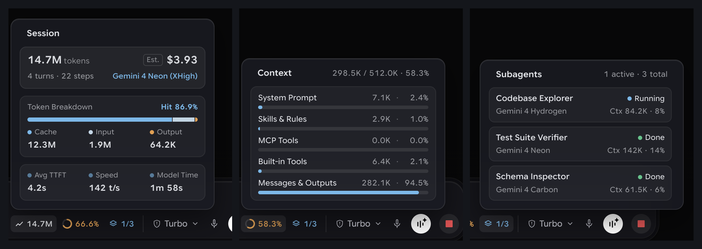
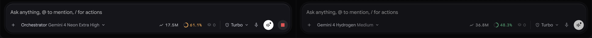
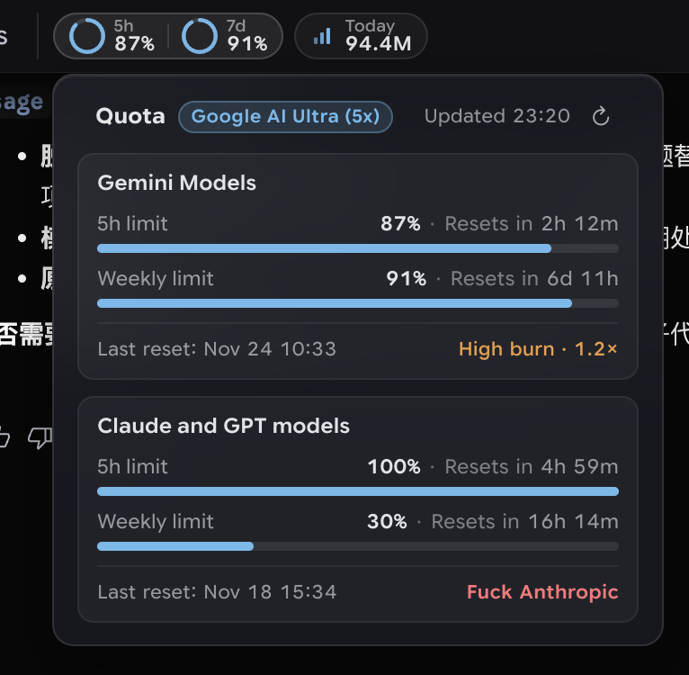
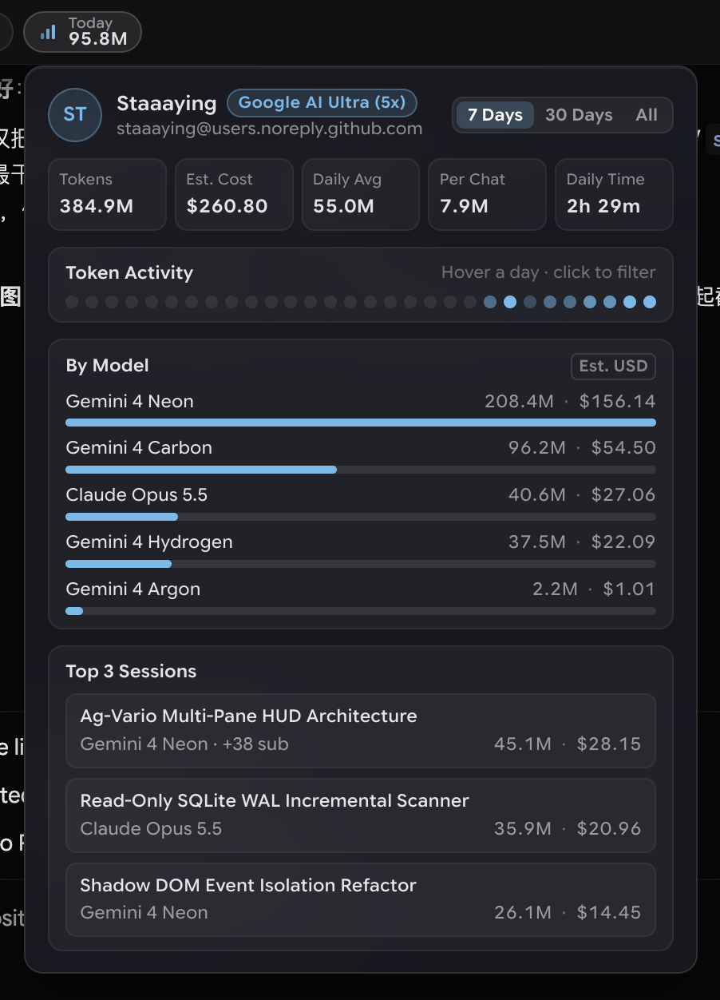

# ag-vario

**English** · [简体中文](README.zh-CN.md)

[](#quick-start)
[](#quick-start)
[](#quick-start)
[](#highlights)
[](LICENSE)

A lightweight, read-only observability plugin for **Antigravity Desktop on macOS**.

Named after a glider's *Variometer* — an instrument that shows altitude changes at a glance — `ag-vario` surfaces key runtime metrics in Antigravity with minimal performance and visual overhead.

---

## Screenshots





<table>
  <tr>
    <td align="center" valign="top">
      <br />
      <sub><strong>Quota</strong> — 5h / Weekly pools &amp; burn pace</sub>
    </td>
    <td align="center" valign="top">
      <br />
      <sub><strong>Usage</strong> — 30-day heatmap, models &amp; top sessions</sub>
    </td>
  </tr>
</table>

---

## Highlights

- **Native look & feel**: Dark frosted-glass styling that blends into Antigravity, with zero background rendering when panels are closed.
- **Strictly read-only**: Only reads local session data and local endpoints; never modifies prompts, model settings, or network traffic.
- **Zero third-party dependencies**: Built solely on Node.js built-ins — no `npm install` needed — with bundled install and lossless restore scripts.

---

## Features

### Chat Composer Bar (Per Session · Split-Pane Ready)
Shown in the bottom toolbar of every visible chat pane (supports 2 / 3 / 4 split panes independently):

- **`Session`**: Total session tokens, estimated API cost (USD), turns & steps, active model and reasoning effort, Cache / Input / Output breakdown with cache hit rate, average TTFT, output speed, and model time.
- **`Context`**: Context usage ring (`<50%` green, `50%–79%` orange, `≥80%` red); click to view an estimated 5-category breakdown (`System Prompt`, `Skills & Rules`, `MCP Tools`, `Built-in Tools`, `Messages & Outputs`).
- **`Subagents`**: Active and total subagent count; click to inspect each subagent's status (`Running` / `Done` / `Error`), model, and context usage.

### Window Titlebar (Account-Wide)
- **`Quota`**: Dual rings for `5h` and `7d` remaining quota in the current model pool; click to view plan details, per-pool progress bars, reset countdowns, and weekly burn pace.
- **`Usage`**: Today's token total; click to view account info, period switching (`7 Days` / `30 Days` / `All`), 5 summary metrics (total tokens, estimated cost, daily average, per-chat average, daily model time), a 30-day activity heatmap (click a day to filter), model breakdown, and top 3 sessions.

---

## Quick Start

**Requirements**: macOS · Antigravity 2.0 Desktop (tested on `v2.34.0`) · Node.js `>= 22.5.0`

### Install

```bash
# Back up original app.asar and install ag-vario
npm run hud:install
```

After installing, **completely quit Antigravity (`Cmd+Q`) and reopen it**.

### Uninstall / Restore

```bash
# Losslessly restore the original unmodified app.asar
npm run hud:restore
```

Restart Antigravity afterward to finish restoring.

### Installing with an AI Assistant

If you ask an AI assistant to install `ag-vario`:
1. Run `npm run hud:install` in the repository root (optionally run `npm test` first).
2. Do not force-kill a running Antigravity process; quit (`Cmd+Q`) and reopen manually after installation finishes.

---

## Notes

- **Cost & estimates**: Costs are estimated from public API rates (USD), priced per session using the first model called; the 5-category context breakdown is an estimate based on content size.
- **MCP category**: `MCP Tools` classification is implemented against the client's data schema, but has not yet been verified against a live MCP server.
- **App updates**: Updating Antigravity overwrites its application bundle; re-run `npm run hud:install` after an update.
- **Local storage**: Original backups and plugin caches are stored under `~/Library/Application Support/ag-vario/`, without writing to Antigravity's own data directory.

---

## Project Structure

```text
ag-vario/
├── src/
│   ├── core/       # Core calculations (usage, cost, quota, context breakdown)
│   ├── main/       # Read-only local data collection & main-process bridge
│   └── renderer/   # Titlebar & composer UI components
├── scripts/        # Installer & lossless restore scripts
├── test/           # Unit tests (npm test)
└── docs/           # Design specification
```

---

## Acknowledgements & License

- Low-level app injection and local API conventions reference [antigravity-context-viewer](https://github.com/elviscjn-cjn/antigravity-context-viewer) (MIT License).
- Released under the [MIT License](LICENSE).
