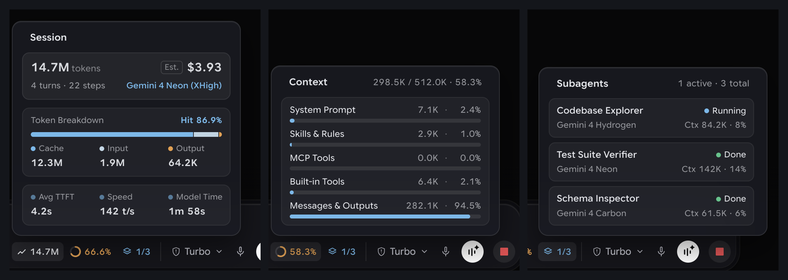
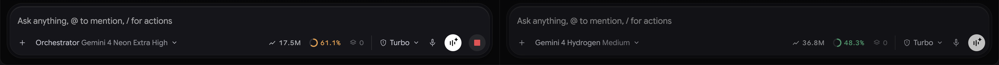
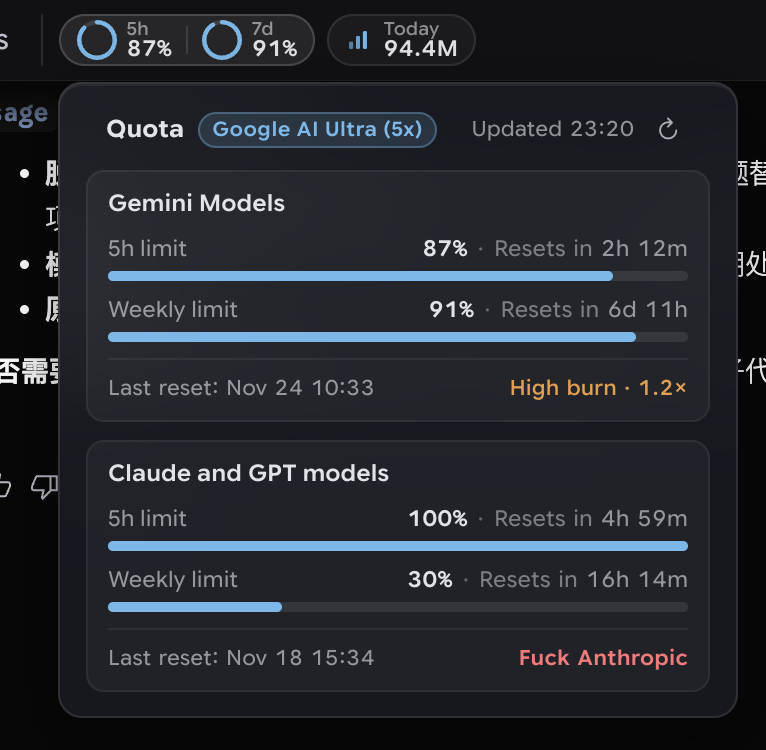
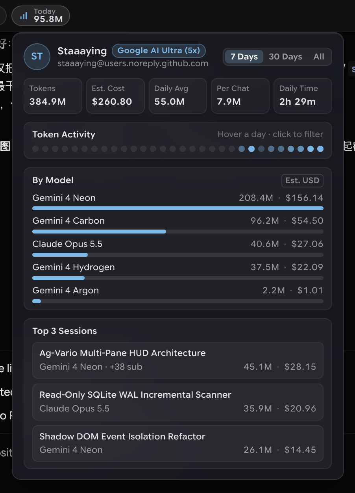

# ag-vario

[English](README.md) · **简体中文**

[](#快速开始)
[](#快速开始)
[](#快速开始)
[](#特点)
[](LICENSE)

面向 **macOS Antigravity 桌面端**的轻量、只读运行信息观测插件。

`vario` 取自滑翔机仪表 *Variometer（升降速度表）*——飞行员余光一扫即可感知高度变化。`ag-vario` 以极低的性能与视觉侵入代价，在 Antigravity 使用过程中即时呈现关键运行信息。

---

## 界面预览





<table>
  <tr>
    <td align="center" valign="top">
      <br />
      <sub><strong>Quota</strong> — 5 小时 / 每周额度池与消耗速率</sub>
    </td>
    <td align="center" valign="top">
      <br />
      <sub><strong>Usage</strong> — 30 天热力图、模型占比与会话排行</sub>
    </td>
  </tr>
</table>

---

## 特点

- **融入原生界面**：毛玻璃风格自动适配 Antigravity 深色与浅色主题，面板收起时零后台渲染开销。
- **纯只读观测**：所有会话、上下文与用量数据均在本地只读处理，不上传对话或遥测，不改动提示词、模型配置或宿主网络请求。
- **零第三方依赖**：仅使用 Node.js 原生能力，无需 `npm install`，自带安装与一键无损还原脚本。

---

## 功能一览

### 对话输入栏（单会话）
显示在每个可见对话窗格的输入框底部工具栏（支持 2 / 3 / 4 分屏各自独立显示）：

- **`Session`**：当前会话总 Token、预估 API 费用（USD）、对话轮数与步数、当前模型与推理档位、Cache / Input / Output 分布与缓存命中率、平均首字延迟（TTFT）、输出速度与模型耗时。
- **`Context`**：上下文使用率圆环（`<50%` 绿、`50%–79%` 橙、`≥80%` 红，触发压缩后环心显示压缩次数），点击展开压缩详情与 5 大类占用估算（`System Prompt`、`Skills & Rules`、`MCP Tools`、`Built-in Tools`、`Messages & Outputs`）。
- **`Subagents`**：子代理运行数与总数，点击查看各子代理状态（`Running` / `Done` / `Error`）、所用模型与上下文占用。

### 窗口顶栏（全局账号）
- **`Quota`**：双圆环展示当前模型池的 `5h` 与 `7d` 剩余额度；点击展开套餐信息、各模型池进度条、重置倒计时与周消耗速率。
- **`Usage`**：展示今日 Token 用量；点击展开账号信息、周期切换（`7 Days` / `30 Days` / `All`）、5 项汇总指标（总 Token、预估费用、日均用量、单会话均值、日均模型时长）、30 天活跃热力图（点击某天可筛选下方数据）、模型用量对比与会话用量 Top 3。

---

## 快速开始

**环境要求**：macOS · Antigravity 2.0 桌面端（已验证版本 `v2.35.1`）· Node.js `>= 22.13.0`（零依赖，无需 `npm install`）

### 安装

```bash
git clone https://github.com/Staaaying/ag-vario.git
cd ag-vario
npm run hud:install
```

安装完成后，**完全退出 Antigravity（`Cmd+Q`）并重新打开**即可生效。

> 默认安装至 `/Applications/Antigravity.app`；如路径不同，可执行 `node scripts/install.js --target "<app.asar 路径>"`。

### 更新与卸载

```bash
# 更新插件（或 Antigravity 升级后重装）
cd ag-vario && git pull && npm run hud:install

# 卸载并无损还原原版 app.asar
cd ag-vario && npm run hud:restore
```

操作完成后重启 Antigravity 即可。

### 交给 AI 助手安装

直接在 Antigravity 中发送即可：

> 帮我把 `https://github.com/Staaaying/ag-vario` 克隆到本地并按 README 完成安装，不要强杀 Antigravity，装完提醒我手动重启。

---

## 说明

- **隐私与网络**：所有会话、上下文和用量统计均在本地完成，不上传对话或遥测。仅有的外网只读 HTTPS 请求为每日同步 Google（`ai.google.dev`）与 Anthropic（`platform.claude.com`）官方公开定价页（离线自动回退内置费率），以及拉取并缓存宿主返回的 `profilePictureUrl` 头像（失败时回退为姓名首字母）。
- **费用与估算**：费用基于公开 API 单价折算（USD），单会话按首次调用的模型计价；上下文 5 类占比为按内容体量估算的参考值。
- **MCP 分类**：`MCP Tools` 分类已按客户端数据结构实现，但暂未在连接真实 MCP 服务器的环境下验证。
- **应用签名与还原**：安装会改写 `app.asar` 并使原应用代码签名失效；执行 `npm run hud:restore` 可逐字节无损还原原版 `app.asar` 并恢复官方签名。
- **客户端更新与排障**：Antigravity 更新会覆盖应用文件，升级后重新执行一次 `npm run hud:install` 即可。遇到写权限报错时请检查 `/Applications/Antigravity.app` 的写权限（避免直接使用 `sudo`，以免缓存目录属主变为 `root`）；若提示找不到洁净的 `app.asar` 源（例如已被其他插件修改），请重装官方 Antigravity 或通过 `--clean-source <path>` 指定原版路径。
- **本地数据位置**：原版备份与插件缓存均保存在 `~/Library/Application Support/ag-vario/`，不会写入 Antigravity 自身数据目录。

---

## 项目结构

```text
ag-vario/
├── src/
│   ├── core/       # 核心计算（用量、费用、额度、上下文拆分）
│   ├── main/       # 本地只读数据采集与主进程桥接
│   └── renderer/   # 顶栏与输入栏界面组件
├── scripts/        # 安装与无损还原脚本
├── test/           # 单元测试（npm test）
└── docs/           # 设计文档
```

---

## 致谢与协议

- 部分底层注入方式与本地接口调用参考自 [antigravity-context-viewer](https://github.com/elviscjn-cjn/antigravity-context-viewer)（MIT License）。
- 本项目采用 [MIT License](LICENSE) 开源。
